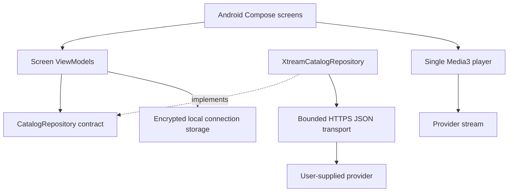
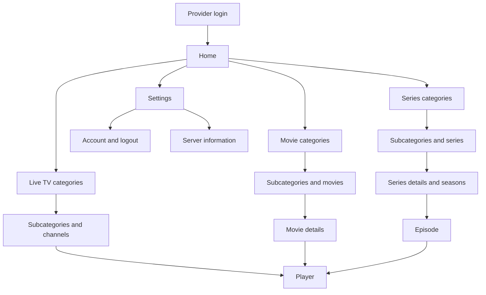

# Architecture

## Product decisions

- Phones and tablets first; Android TV after the mobile release criteria are met.
- Native Kotlin, Jetpack Compose, lifecycle-aware ViewModels, coroutines and Flow.
- Xtream-compatible provider login: HTTP or HTTPS base URL, username and password.
- No separate application account or backend in the initial release.
- One active provider connection and one player at a time.
- Account APIs, video and artwork accept HTTP and HTTPS automatically. HTTPS retains platform certificate verification; HTTP traffic is unencrypted.
- Android 8.0 (API 26) minimum for the first baseline; compile and target API 36.
- English by default with ten interface languages; see [localization](LOCALIZATION.md).

The build pins AGP 9.1.0, Gradle 9.3.1 and Kotlin/Compose compiler 2.2.10. AGP provides built-in Kotlin for Android; do not also apply `org.jetbrains.kotlin.android`. Android dependencies are pinned in the version catalog. These are explicit baseline versions, not a claim that every dependency is the newest release.

Lint treats correctness warnings as errors. Dependency-version and target-SDK migration notices remain informational. Dependencies are handled through Dependabot review; the deliberately pinned API 36 target must be reviewed against current platform/store requirements before release. This avoids an unrelated upstream release unexpectedly breaking a development build.

## Boundaries

`core:model` has no Android or networking dependency. `core:provider` implements the repository contract and translates provider JSON into application models. The application creates dependencies once in `ReceiverApplication` and injects them explicitly into ViewModels. Composables never make HTTP requests.

Optional `ContentMetadata` enriches catalog and detail models at the provider boundary. Browsing uses only metadata returned by the list request; details are fetched only when opened. Missing detail fields preserve listing metadata. Catalog sort and genre selection are saved with the navigation entry, along with the grid position. Details use a compact phone layout, expandable synopsis/credits, a reachable movie Play action and one selected season at a time. Extra artwork still loads only while visible. Provider metadata and external trailer URLs are not added to durable watch history.

Home contains four icon-and-label destinations and a Settings action. Account details/logout, server information and the language picker live under Settings. Login retains a language icon before authentication; content screens keep the header focused on Back and the current title. Optional server timezone/clock values are settings-only sign-in snapshots, never used to rewrite the connection or playback address.

Settings also contains a parental panel with memory-only authentication. `ParentalControls` persists a salted password verifier and immutable policy; its default policy blocks adult content even before setup. Reset constructs the default policy and removes the password and all account/category selections atomically. `ParentalCatalogRepository` wraps the provider contract to enforce category descendants, provider adult flags and adult labels consistently, including all-title searches and stream resolution. The panel alone uses the unfiltered repository after password verification to list categories. Policy revisions recreate catalog ViewModels and clear/refilter visible history. History identifiers are resolved against provider listings so legacy records cannot bypass category restrictions. Provider failures and unreadable settings fail closed. See [security](../SECURITY.md#parental-controls) for storage, reset behavior and classification limits.

Keep feature screens in `app/ui` until separate ownership, independent build needs or TV reuse justify a Gradle module. Avoid an empty module for each screen. Shared player/storage modules can be extracted when TV work starts.

## Navigation

Nested category routes can repeat. Branch categories may also contain media, so the browser requests both child categories and media for the selected category. Root categories with absent/missing parents remain accessible. Cyclic provider hierarchies need an explicit fallback before broad provider support is claimed.

Navigation arguments contain only content types and IDs. Credentials and playback URLs stay in memory and never enter navigation routes or saved-state bundles. The current selected detail item is held in the session ViewModel. Full restoration of a detail/player route after process death is a future release gate, not an implemented capability.

## State and lifecycle

Each screen ViewModel exposes immutable state with loading, data and error values. The UI collects it with `collectAsStateWithLifecycle`. Retry cancels an earlier load. Cancellation propagates to OkHttp. The unfinished login form uses an activity ViewModel across configuration changes and is cleared after authentication; credentials do not use SavedStateHandle. Parental password fields use memory-only Compose state.

The player is owned by the player destination. It pauses when the destination stops and releases its resources when removed. Background playback and a `MediaSessionService` are future product decisions. It uses device decoders; a supported container does not guarantee support for every embedded codec.

## Persistence plan

Optional encrypted connection storage and durable watch history are implemented. Watch history uses a versioned binary file per provider account under `filesDir/watch-history`, with synchronized reads/writes and atomic replacement. Account filenames hash the normalized server address and username; connection names and password changes do not create a new history. Records contain content type, content/episode identifiers, display titles, stream extensions and the last playback-start timestamp. Artwork and playback URLs are never serialized. Schema version 1 is checked on read; unsupported versions fail visibly without overwriting existing data.

History records only the first `isPlaying` event of each playback session. Rewatching replaces the same content/episode entry and sorts it first. Entries expire exactly 10 days after the last watch; reads, writes and daily maintenance prune expired entries. The history screen refreshes on resume and at the next expiration while visible. Cache cleanup only targets cache directories, so it preserves unexpired history. Signing out hides account history but leaves it available for the next login to that account.

Catalog search, refinements and results share one lazy scroll container, with compact rows for large fonts or short windows. All three content roots can load a protected full catalog on demand; search defaults to relevance while preserving explicit sort choices. Catalog grids save their position with Compose state scoped to the Navigation entry. Changing the search query or All movies mode creates a new grid state; returning from details or playback restores the existing state without a scroll-to-top effect. This covers in-session navigation and configuration changes; complete catalog/detail restoration after process death remains planned.

Movie/episode checkpoints use a separate version-1 atomic store under `filesDir/playback-progress`, keyed by provider/account and title/episode identifiers. History's existing schema remains unchanged and receives progress at read time. Checkpoints survive recent-history expiry, logout and cache cleanup; neither stream addresses nor credentials are stored. PlaybackViewModel emits checkpoints only after playback starts, and an application-owned I/O scope completes final saves after navigation removes the player. Saved seeks run before preparation; near-end/ended titles are completed. See [playback lifecycle](CACHE_AND_PLAYBACK.md#durable-movie-and-episode-progress) for thresholds and process-kill limits.

`SubscriptionReminders` evaluates the provider's authentication expiry using local calendar dates and stores account/expiry-specific acknowledgement times under `filesDir/subscription-reminders`. ReceiverViewModel exposes notices; the foreground navigation host checks on resume and every minute while browsing, suppressing popups during playback and resume choices. No background notification job is created.

Add Room for category/item metadata and DataStore for further non-sensitive settings when those features are implemented. Scope every persisted record by provider account and content type. Add migration tests alongside schema changes.

## References

- [Android architecture recommendations](https://developer.android.com/topic/architecture/recommendations)
- [Android modularization guidance](https://developer.android.com/topic/modularization)
- [AGP and Gradle compatibility](https://developer.android.com/build/releases/about-agp)
- [Media3 format support](https://developer.android.com/media/media3/exoplayer/supported-formats)
- [Compose for TV](https://developer.android.com/training/tv/playback/compose)
