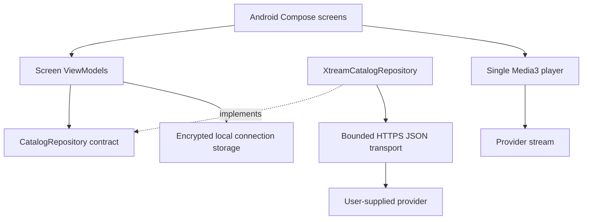
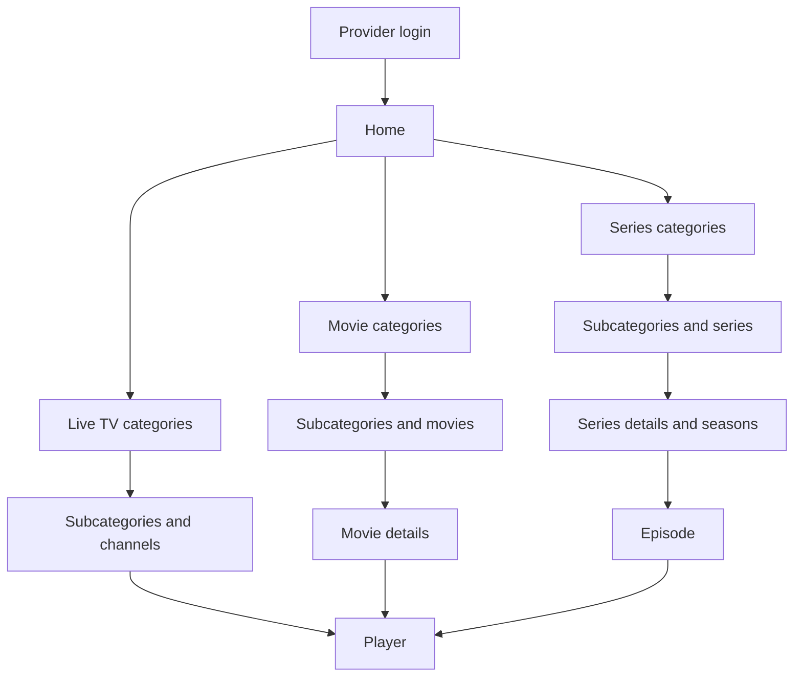

# Architecture

## Product decisions

- Phones and tablets first; Android TV after the mobile release criteria are met.
- Native Kotlin, Jetpack Compose, lifecycle-aware ViewModels, coroutines and Flow.
- Xtream-compatible provider login: HTTPS base URL, username and password.
- No separate application account or backend in the initial release.
- One active provider connection and one player at a time.
- Account APIs require HTTPS; unencrypted video delivery has a separate, default-off, per-connection opt-in.
- Android 8.0 (API 26) minimum for the first baseline; compile and target API 36.
- English by default with ten interface languages; see [localization](LOCALIZATION.md).

The build pins AGP 9.1.0, Gradle 9.3.1 and Kotlin/Compose compiler 2.2.10. AGP provides built-in Kotlin for Android; do not also apply `org.jetbrains.kotlin.android`. Android dependencies are pinned in the version catalog. These are explicit baseline versions, not a claim that every dependency is the newest release.

Lint treats correctness warnings as errors. Dependency-version and target-SDK migration notices remain informational. Dependencies are handled through Dependabot review; the deliberately pinned API 36 target must be reviewed against current platform/store requirements before release. This avoids an unrelated upstream release unexpectedly breaking a development build.

## Boundaries

`core:model` has no Android or networking dependency. `core:provider` implements the repository contract and translates provider JSON into application models. The application creates dependencies once in `ReceiverApplication` and injects them explicitly into ViewModels. Composables never make HTTP requests.

Keep feature screens in `app/ui` until separate ownership, independent build needs or TV reuse justify a Gradle module. Avoid an empty module for each screen. Shared player/storage modules can be extracted when TV work starts.

## Navigation

Nested category routes can repeat. Branch categories may also contain media, so the browser requests both child categories and media for the selected category. Root categories with absent/missing parents remain accessible. Cyclic provider hierarchies need an explicit fallback before broad provider support is claimed.

Navigation arguments contain only content types and IDs. Credentials and playback URLs stay in memory and never enter navigation routes or saved-state bundles. The current selected detail item is held in the session ViewModel. Full restoration of a detail/player route after process death is a future release gate, not an implemented capability.

## State and lifecycle

Each screen ViewModel exposes immutable state with loading, data and error values. The UI collects it with `collectAsStateWithLifecycle`. Retry cancels an earlier load. Cancellation propagates to OkHttp. Password fields use memory-only Compose state.

The player is owned by the player destination. It pauses when the destination stops and releases its resources when removed. Background playback and a `MediaSessionService` are future product decisions. It uses device decoders; a supported container does not guarantee support for every embedded codec.

## Persistence plan

Only optional encrypted connection storage is implemented today. Add Room for category/item metadata and watch progress, and DataStore for non-sensitive settings when those features are implemented. Scope every persisted record by provider account and content type. Store identifiers and progress instead of credential-bearing playback URLs. Add migration tests alongside the first schema change.

## References

- [Android architecture recommendations](https://developer.android.com/topic/architecture/recommendations)
- [Android modularization guidance](https://developer.android.com/topic/modularization)
- [AGP and Gradle compatibility](https://developer.android.com/build/releases/about-agp)
- [Media3 format support](https://developer.android.com/media/media3/exoplayer/supported-formats)
- [Compose for TV](https://developer.android.com/training/tv/playback/compose)
