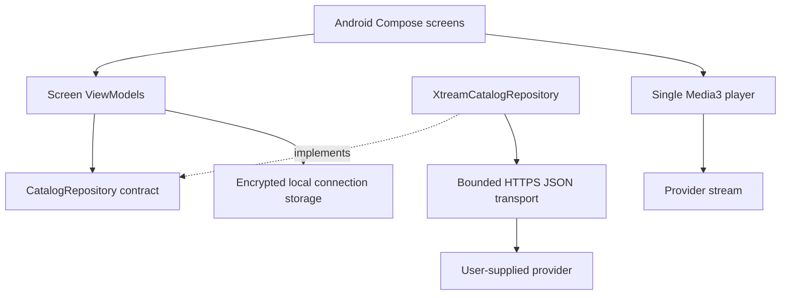
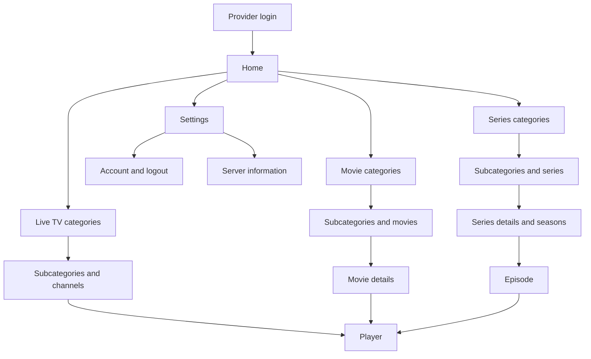

# Architecture

## Product decisions

The implemented application is Android. The product direction also includes Windows,
LG webOS and Samsung Tizen, with installed applications and performance assessed on
each platform. The platform expansion below is a design direction, not a claim that
those additional clients or their playback integrations have been implemented.

- Phones and tablets first; Android TV after the mobile release criteria are met.
- Native Kotlin, Jetpack Compose, lifecycle-aware ViewModels, coroutines and Flow.
- Xtream-compatible provider login: HTTP or HTTPS base URL, username and password.
- No separate application account or backend in the initial release.
- One active provider connection and one player at a time.
- Account APIs, video and artwork accept HTTP and HTTPS automatically. HTTPS retains platform certificate verification; HTTP traffic is unencrypted.
- Android 8.0 (API 26) minimum for the first baseline; compile and target API 36.
- English by default with ten interface languages; see [localization](LOCALIZATION.md).

The build pins AGP 9.1.0, Gradle 9.3.1 and Kotlin/Compose compiler 2.2.10. AGP provides built-in Kotlin for Android; do not also apply `org.jetbrains.kotlin.android`. Android dependencies are pinned in the version catalog. These are explicit baseline versions, not a claim that every dependency is the newest release.

Lint treats correctness warnings as errors. Dependency-version and target-SDK migration notices remain informational. Dependencies are handled through Dependabot review; the deliberately pinned API 36 target must be reviewed against current platform/store requirements before release. This avoids an unrelated upstream release unexpectedly breaking a development build.

## Platform expansion

The priority is reliable playback and responsive interaction on each device.
Code sharing must preserve access to the platform's media pipeline, hardware
decoders, lifecycle, input and storage facilities. Framework choice alone does
not establish which implementation is fastest; measure release builds on hardware.

### Initial implementation candidates

| Platform | Application and interface | Playback boundary |
| --- | --- | --- |
| Android | Retain Kotlin and Jetpack Compose | Retain Media3 and the existing recovery/session handling |
| Windows | C# and WinUI 3 as the initial native desktop candidate | Evaluate Windows MediaPlayer/Media Foundation against the required streams before selecting the engine |
| LG webOS | Evaluate the vendor's compiled Flutter SDK | Prove the public native media integration, supported formats and release eligibility before porting features |
| Samsung Tizen | Evaluate Flutter for Tizen, allowing TV code reuse with LG | Use the supported TV media integration; verify playback, plugin/toolchain compatibility and distribution |

Flutter uses its own rendered widgets; compiling an application with Flutter does
not make it use Windows, Android or TV system widgets. The proposed TV clients
would be compiled applications rather than hosted websites. Their common source
must still build separately with each vendor's SDK. No migration of the existing
Android interface to Flutter is implied.

Vendor documentation checked on 2026-10-27:

- [LG Flutter SDK requirements](https://github.com/lg-flutter-webos/flutter-webos/blob/main/doc/getting-started.md):
  webOS 26 Re:New or later; Ubuntu is the supported build host, with WSL2 or a
  compatible container suggested for Windows. The web simulator does not validate
  this native application's media integration.
- [Samsung Flutter TV support](https://developer.samsung.com/smarttv/develop/native/flutter.html):
  Tizen 6.0 / 2021 models or later. Use the required current TV SDK and compatible
  native libraries. [Distribution instructions](https://github.com/flutter-tizen/flutter-tizen/blob/main/doc/publish-app.md)
  require release-device testing and describe partnership requirements for
  distribution outside the United States.
- [Windows media playback](https://learn.microsoft.com/en-us/windows/apps/develop/media-playback/media-playback):
  WinUI 3 integrates Windows playback facilities, including adaptive streaming.
  This does not establish compatibility with every provider codec or transport.

The owner selected compiled native applications on supported TVs as the priority.
The planning baselines are webOS 26 Re:New or later for LG and Tizen 6.0 / 2021
models or later for Samsung. Exact model groups and test devices still need to be
identified. An older-TV web application is outside this plan. Confirm LG's public
playback APIs and Store submission path for the native package; developer-mode
installation alone does not prove release eligibility.

This work is planning only. Implementing clients, installing SDKs, changing
application code, creating releases and submitting to stores are separate work.

### What to share

- Share provider operation definitions, normalized data contracts, error meanings,
  parental-control behavior, history/progress semantics and feature acceptance
  criteria across all clients. Use one set of synthetic input/expected-output
  fixtures to verify independent implementations.
- Reuse translations, original artwork and design conventions, adapting layout,
  focus, typography and navigation for touch, desktop and remote control.
- Keep the existing Kotlin models/provider modules reusable by Android clients.
  They are JVM modules today, not portable binaries for WinUI or the TV SDKs.
- If both TV prototypes pass, share Dart provider/domain logic and appropriate TV
  interface components between the Flutter clients. Keep player, storage, input
  and lifecycle integrations behind explicit platform boundaries. Share only
  dependencies compatible with both vendor toolchains.
- Introduce a common compiled library across additional languages only after a
  measured benefit and successful packaging/distribution proof. A universal FFI
  layer is not a prerequisite for starting Windows or TV development.

Each client owns its HTTP implementation, secure credential handling, local
persistence, media session and hardware decoder integration. Preserve TLS
validation, credential redaction, account isolation and default parental blocking
from [security](../SECURITY.md). Shared fixtures must contain fictional providers
and media identifiers; private account responses must never become fixtures.

### Playback and performance proof

Before a full feature port, build a small client per new platform that can log in,
read a bounded catalog, play a live channel and play/seek a movie or episode.
Cover HLS and progressive MPEG-TS where required, HTTP/HTTPS delivery and redirects,
session expiry/reconnect, audio/subtitle selection and supported codecs. The
existing Android implementation is the behavioral reference, not proof that a TV
or Windows player supports the same input.

Record device/model, firmware, SDK, release build, stream format and test procedure
with cold/warm launch time, time to first frame, channel-switch time, seek/recovery
latency, frame drops, CPU and peak/steady memory. Confirm hardware decoding where
the device exposes evidence. Evaluate catalog scrolling/search at repeatable sizes
and verify cancellation and player release. Establish budgets from those baselines;
do not label an unmeasured implementation as providing maximum performance.

Physical TV playback is a release gate. Simulator, emulator, build and contract
test results remain useful but cannot replace it. Complete native SDK/media and
Store eligibility checks before expanding TV features or restructuring shared code.

## Boundaries

`core:model` has no Android or networking dependency. `core:provider` implements the repository contract and translates provider JSON into application models. The application creates dependencies once in `ReceiverApplication` and injects them explicitly into ViewModels. Composables never make HTTP requests.

Optional `ContentMetadata` enriches catalog and detail models at the provider boundary. Browsing uses only metadata returned by the list request; details are fetched only when opened. Missing detail fields preserve listing metadata. Catalog sort and genre selection are saved with the navigation entry, along with the grid position. Details use a compact phone layout, expandable synopsis/credits, a reachable movie Play action and one selected season at a time. Extra artwork still loads only while visible. Provider metadata and external trailer URLs are not added to durable watch history.

Home contains four icon-and-label destinations and a Settings action. Account details/logout, server information and the language picker live under Settings. Login retains a language icon before authentication; content screens keep the header focused on Back and the current title. Optional server timezone/clock values are settings-only sign-in snapshots, never used to rewrite the connection or playback address.

Settings also contains a parental panel with memory-only authentication. `ParentalControls` persists a salted password verifier and immutable policy; its default policy blocks adult content even before setup. Reset constructs the default policy and removes the password and all account/category selections atomically. `ParentalCatalogRepository` wraps the provider contract to enforce category descendants, provider adult flags and adult labels consistently, including all-title searches and stream resolution. The panel alone uses the unfiltered repository after password verification to list categories. Policy revisions recreate catalog ViewModels and clear/refilter visible history. History identifiers are resolved against provider listings so legacy records cannot bypass category restrictions. Provider failures and unreadable settings fail closed. See [security](../SECURITY.md#parental-controls) for storage, reset behavior and classification limits.

Keep feature screens in `app/ui` until separate ownership, independent build needs or TV reuse justify a Gradle module. Avoid an empty module for each screen. Shared player/storage modules can be extracted when TV work starts.

## Navigation

Nested category routes can repeat. Branch categories may also contain media, so the browser requests both child categories and media for the selected category. Root categories with absent/missing parents remain accessible. Cyclic provider hierarchies need an explicit fallback before broad provider support is claimed.

Navigation arguments contain only content types and IDs. Credentials and playback URLs stay in memory and never enter navigation routes or saved-state bundles. The current selected detail item is held in the session ViewModel. Full restoration of a detail/player route after process death is a future release gate, not an implemented capability.

## State and lifecycle

Each screen ViewModel exposes immutable state with loading, data and error values. The UI collects it with `collectAsStateWithLifecycle`. Retry cancels an earlier load. Cancellation propagates to OkHttp. The unfinished login form uses an activity ViewModel across configuration changes and is cleared after authentication; credentials do not use SavedStateHandle. Parental password fields use memory-only Compose state.

The player is owned by the player destination. It pauses when the destination stops and releases its resources when removed. Background playback and a `MediaSessionService` are future product decisions. It uses device decoders; a supported container does not guarantee support for every embedded codec.

## Persistence plan

Optional encrypted connection storage and durable watch history are implemented. `ViewingStore` owns a version-1 app-private SQLite database with indexed progress/history tables and transactional writes. Account keys hash normalized server/account identifiers; connection names and password changes do not create new history. History records contain content/episode identifiers, display titles, stream extensions and last playback-start timestamps. Artwork, provider responses, playback URLs and credentials are never serialized. Old atomic files import once per account in one transaction. Unsupported versions fail visibly without overwriting sources; import markers prevent old files from resurrecting subsequent edits or cleared data.

History records only the first `isPlaying` event of each playback session. Rewatching replaces the same content/episode entry and sorts it first. Movie/episode entries expire after 180 days; live entries after ten days. Reads and daily maintenance prune expired entries. History reads 50 entries initially, with explicit loading of older entries, and resolves parental visibility before displaying progress. It refreshes on resume and at the next expiration while visible. Cache cleanup preserves unexpired history. Signing out hides history without deleting it; Settings offers confirmed account-specific clearing.

Catalog search, refinements and results share one lazy scroll container, with compact rows for large fonts or short windows. All three content roots can load a protected full catalog on demand; search defaults to relevance while preserving explicit sort choices. Catalog grids save their position with Compose state scoped to the Navigation entry. Changing the search query or All movies mode creates a new grid state; returning from details or playback restores the existing state without a scroll-to-top effect. This covers in-session navigation and configuration changes; complete catalog/detail restoration after process death remains planned.

Movie/episode checkpoints update one indexed progress row. They survive recent-history expiry, logout and cache cleanup until explicit clearing. The watched flag is independent of the current viewing’s completion/position; rewatching preserves it. `DetailsViewModel` reads only the selected title’s progress, persists manual marks and reports storage failures separately from provider errors. Details display progress and watched counts and select a continuation episode/season in numeric order. `ReceiverViewModel` publishes checkpoint revisions so returning details refresh even when final application-owned saves finish after player disposal. Parental policy revisions recreate detail ViewModels. Saved seeks run before preparation; ended/95%-played titles complete the current viewing. See [playback lifecycle](CACHE_AND_PLAYBACK.md#durable-movie-and-episode-progress) for migration and process-kill limits.

`SubscriptionReminders` evaluates the provider's authentication expiry using local calendar dates and stores account/expiry-specific acknowledgement times under `filesDir/subscription-reminders`. ReceiverViewModel exposes notices; the foreground navigation host checks on resume and every minute while browsing, suppressing popups during playback and resume choices. No background notification job is created.

Add Room for category/item metadata and DataStore for further non-sensitive settings when those features are implemented. Scope every persisted record by provider account and content type. Add migration tests alongside schema changes.

## References

- [Android architecture recommendations](https://developer.android.com/topic/architecture/recommendations)
- [Android modularization guidance](https://developer.android.com/topic/modularization)
- [AGP and Gradle compatibility](https://developer.android.com/build/releases/about-agp)
- [Media3 format support](https://developer.android.com/media/media3/exoplayer/supported-formats)
- [Compose for TV](https://developer.android.com/training/tv/playback/compose)
